## 1. Introduction to RISC-V and ISA

### What is RISC-V?
RISC-V (Reduced Instruction Set Computer – Five) is an open-standard Instruction Set Architecture (ISA).

- Defines instructions understood by a processor.
- Provides an interface between software and hardware.
- Supports customisable and extensible processor designs.

### What is ISA?
ISA (Instruction Set Architecture) defines how software communicates with hardware.

It specifies:
- Instruction set
- Registers
- Data types
- Instruction formats
- Addressing modes

**Example:**
```asm
add x5, x1, x2
```
Adds the values in registers `x1` and `x2` and stores the result in `x5`.

### RISC-V Extensions

| Extension | Description |
|---|---|
| RV32I | 32-bit base integer ISA |
| RV64I | 64-bit base integer ISA |
| RV64M | Multiplication and division |
| RV64F | Single-precision floating point |
| RV64D | Double-precision floating point |

---

## 2. From Application Software to Hardware
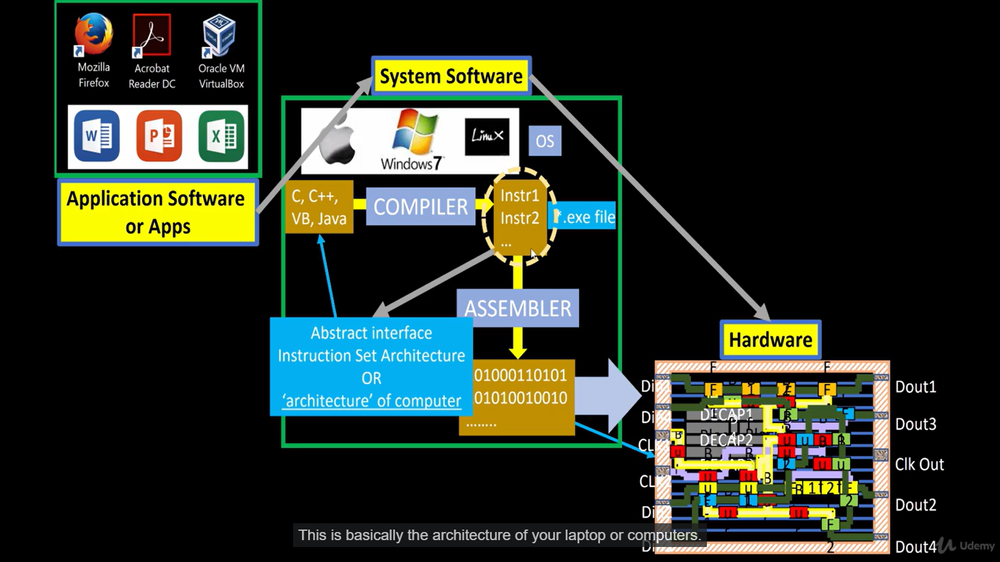

### Compiler
A compiler converts high-level programming languages into lower-level instructions.

Example:
```c
int a = 10;
int b = 20;
int c = a + b;
```

RISC-V assembly:
```asm
li   x5, 10
li   x6, 20
add  x7, x5, x6
```

### Assembler
Converts assembly instructions into binary machine code.

Example:
```asm
add x5, x1, x2
```
Machine code: 0000000000000000000000000000000000000000001000001000001010110011

### Linker
Combines object files and libraries to create an executable file.

### Disassembler
Converts machine-code instructions into readable assembly language.


---

## 3. Compiler and Assembler Flow

| Tool | Function |
|---|---|
| GCC | Compiles C/C++ programs |
| Assembler | Assembly to machine code |
| Linker | Combines object files |
| Objdump | Disassembles machine code |
| Spike | RISC-V instruction set simulator |

**RISC-V GCC:**
```bash
riscv64-unknown-elf-gcc
```

**Compilation example:**
```bash
riscv64-unknown-elf-gcc -O1 -march=rv64i -mabi=lp64 -o sum.o sum.c
```

**Disassembly:**
```bash
riscv64-unknown-elf-objdump -d sum.o
```

---


## Lab 1: C Program to Compute Sum from 1 to N

## Objective
Write a C program to calculate the sum of natural numbers from 1 to N.

## C Program – `sum1ton.c`

```c
#include <stdio.h>

int main()
{
    int i, sum = 0, n = 5;

    for (i = 1; i <= n; i++)
    {
        sum = sum + i;
    }

    printf("Sum of numbers from 1 to %d is %d\n", n, sum);

    return 0;
}
```

## Program Explanation

- `i` – Loop counter.
- `sum` – Stores the accumulated result.
- `n` – Upper limit (5).
- `for` loop – Iterates from 1 to N.
- `sum = sum + i` – Adds each number to the total.

## Execution

## 1. Native GCC Compilation

Compile:
```bash
gcc sum1ton.c
```

Execute:
```bash
./a.out
```

Output:
```text
Sum of numbers from 1 to 5 is 15
```
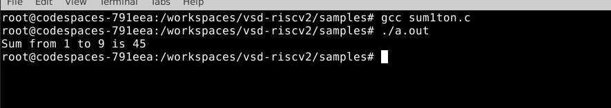
## 2. RISC-V GCC Compilation

Compile using RV64I architecture:

**Optimization level O1:**
```bash
riscv64-unknown-elf-gcc -O1 -mabi=lp64 -march=rv64i -o sum1ton.o sum1ton.c
```

**Optimization level Ofast:**
```bash
riscv64-unknown-elf-gcc -Ofast -mabi=lp64 -march=rv64i -o sum1ton.o sum1ton.c
```
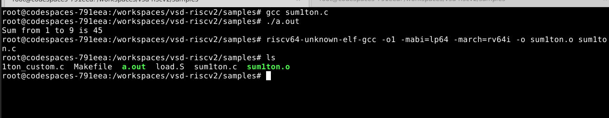
### Compiler options

| Option | Description |
|---|---|
| `riscv64-unknown-elf-gcc` | RISC-V cross-compiler |
| `-O1` | Basic optimisation |
| `-Ofast` | Aggressive optimisation |
| `-mabi=lp64` | 64-bit RISC-V ABI |
| `-march=rv64i` | Target RV64I ISA |
| `-o` | Specifies output filename |

## 3. Disassembly

Convert machine code into readable RISC-V assembly instructions.

```bash
riscv64-unknown-elf-objdump -d sum1ton.o
```

To view output page by page:

```bash
riscv64-unknown-elf-objdump -d sum1ton.o | less
```

## 4. Spike Simulator

Spike is a RISC-V ISA simulator used to execute RISC-V compiled programs.

Execute the program:

```bash
spike pk sum1ton.o
```

Expected output:

```text
Sum of numbers from 1 to 5 is 15
```

## 6. Spike Debugging

Start Spike in debug mode:

```bash
spike -d pk sum1ton.o
```
---
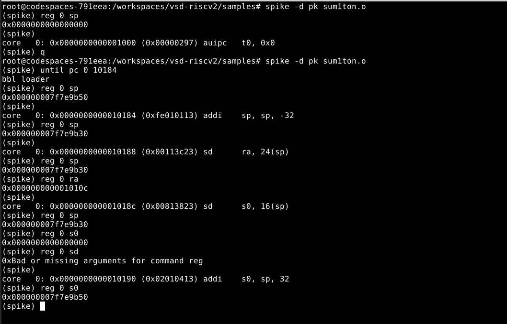


## 4. Integer Number Representation

Computers represent numbers using binary (0 and 1).

### Basic Units

| Unit | Size |
|---|---:|
| Bit | 1 bit |
| Nibble | 4 bits |
| Byte | 8 bits |
| Word | 32 bits |
| Doubleword | 64 bits |

- MSB: Most Significant Bit (leftmost bit).
- LSB: Least Significant Bit (rightmost bit).


---

## 5. Unsigned Integer Representation

Unsigned numbers represent only zero and positive values.

**Formula:**

Maximum = 2^N - 1

Minimum = 0

Range = 0 to (2^N - 1)

| Bits | Minimum | Maximum |
|---|---:|---:|
| 4 | 0 | 15 |
| 8 | 0 | 255 |
| 16 | 0 | 65,535 |
| 32 | 0 | 4,294,967,295 |
| 64 | 0 | 18,446,744,073,709,551,615 |

---

## 6. Signed Integer Representation

Signed numbers represent positive, negative and zero values.

RISC-V uses Two's Complement for signed integer representation.

**Formula:**

Minimum = -2^(N-1)

Maximum = 2^(N-1) - 1

Range = -2^(N-1) to (2^(N-1) - 1)

| Bits | Minimum | Maximum |
|---|---:|---:|
| 4 | -8 | +7 |
| 8 | -128 | +127 |
| 16 | -32,768 | +32,767 |
| 32 | -2,147,483,648 | +2,147,483,647 |
| 64 | -9,223,372,036,854,775,808 | +9,223,372,036,854,775,807 |

### Two's Complement

To represent a negative number:

1. Convert the positive number into binary.
2. Invert all bits (0 → 1, 1 → 0).
3. Add 1.

**Example: Convert +5 to -5 using 8 bits.**

```text
+5       = 00000101
1's comp = 11111010
Add 1    = 11111011

-5       = 11111011
```

---

## 7. LAB
# Lab – RV64 Integer Range and Overflow

## 1. Unsigned Integer – Value 64

**Range (64-bit unsigned):**
```text
0 to 2^64 - 1
```

| Type | Value |
|---|---:|
| Minimum | 0 |
| Maximum | 18446744073709551615 |

case 1: within Limit 
|  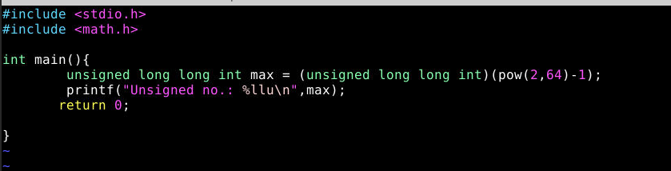 |  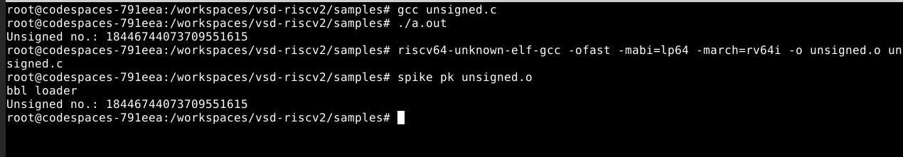 |
case 2: limit exceed
|  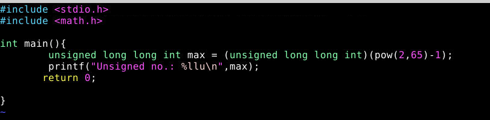 |  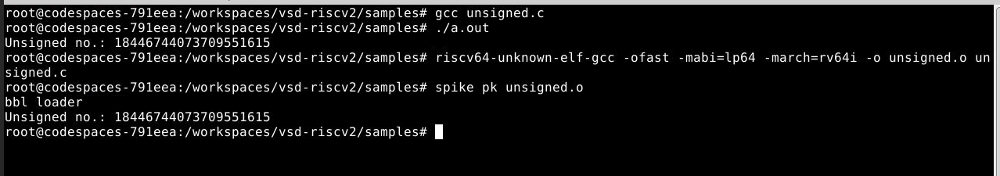 |
case 3: negative value
|  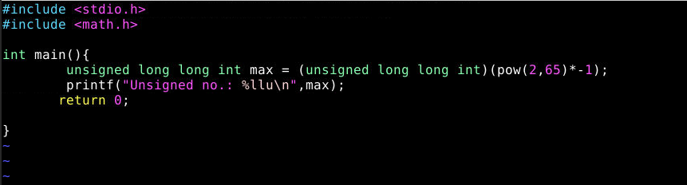 |  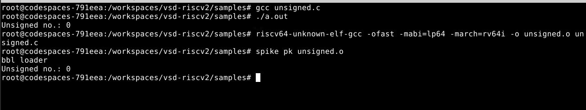 |


## 2. Signed Integer – Maximum and Minimum Values

**Range (64-bit signed):**

```text
-2^63 to 2^63 - 1
```

| Type | Value |
|---|---:|
| Minimum | -9223372036854775808 |
| Maximum | 9223372036854775807 |

|  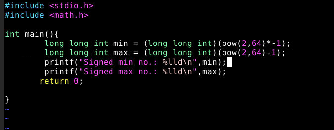 |   |

## 7. Signed vs Unsigned

| Feature | Signed | Unsigned |
|---|---|---|
| Negative numbers | Yes | No |
| Positive numbers | Yes | Yes |
| Zero | Yes | Yes |
| 8-bit range | -128 to +127 | 0 to 255 |
| MSB | Sign-weighted bit | Numeric bit |

---

## 8. RV32 vs RV64

| Feature | RV32 | RV64 |
|---|---|---|
| Register width (XLEN) | 32 bits | 64 bits |
| Register size | 4 bytes | 8 bytes |
| Unsigned range | 0 to 2^32-1 | 0 to 2^64-1 |
| Signed range | -2^31 to 2^31-1 | -2^63 to 2^63-1 |

---


## 10. Day 1 Key Takeaways

- RISC-V is an open-standard ISA.
- ISA connects software and hardware.
- Compiler converts C programs into assembly.
- Assembler converts assembly into machine code.
- Linker generates the executable.
- Processor executes machine instructions.
- Unsigned range = 0 to 2^N - 1.
- Signed range = -2^(N-1) to 2^(N-1) - 1.
- Two's complement represents negative integers.

